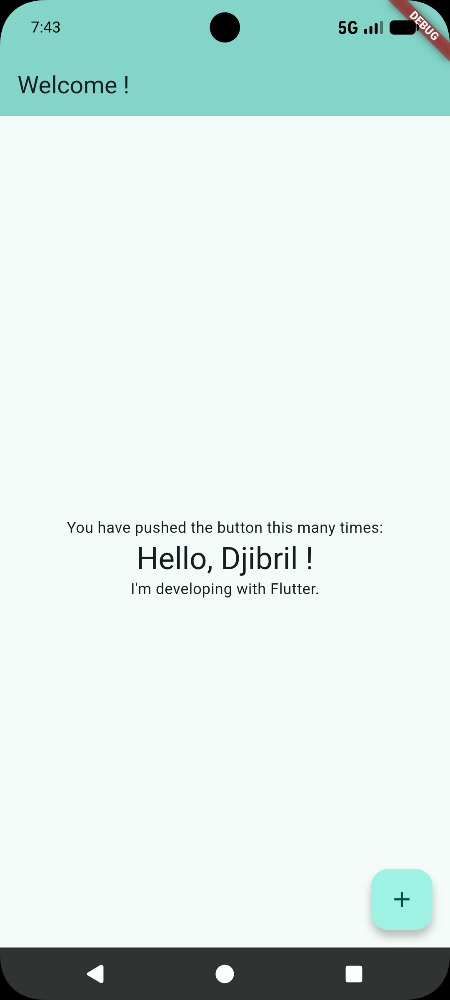
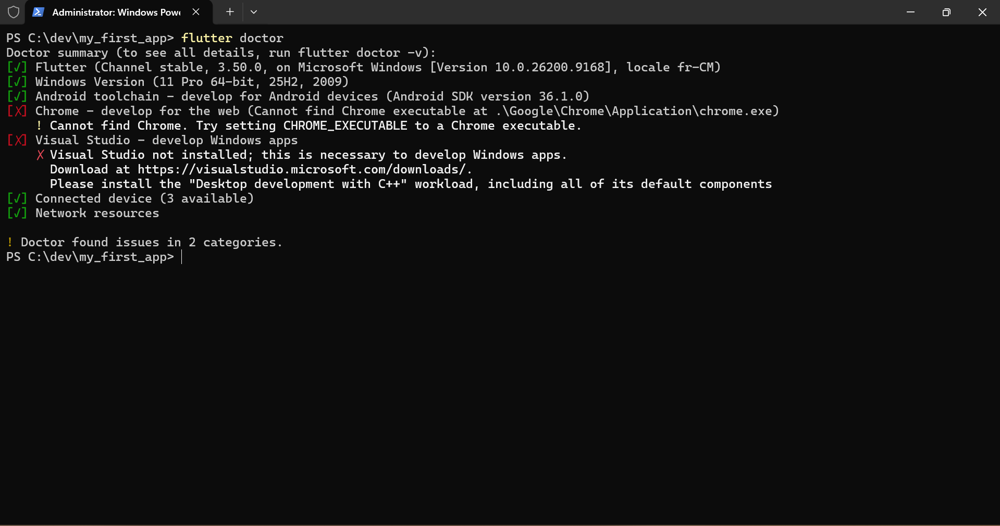

# my_first_app

Lab 1: From zero to a running app on Git.

This project is my first Flutter application, run on an Android device and
versioned with Git and GitHub.

## What I learned and what blocked me

This lab let me install the Flutter toolchain, create an Android emulator and
run my first application. I learned to use hot reload (r), which updates the
app instantly while keeping its state, and hot restart (R), which relaunches it
completely. I also understood that a Column stacks its widgets vertically, and
that the dp is a logical unit that depends on the screen density. Finally, I
used Git and GitHub to save my work with several commits.

What blocked me: at first, the application refused to compile and to launch on
the emulator. By persevering and running the build again, I eventually got it
working. This taught me that the first build is slow and that you sometimes
have to be patient and try again.

## What was done

- Installed the toolchain (Git, Flutter SDK, VS Code, Android Studio) with a
  fully green `flutter doctor`.
- Created an Android device and checked it with `flutter devices`.
- Created and ran `my_first_app`.
- Replaced the counter text with "Hello, Djibril !" and changed the theme
  seed colour.
- Changed the app title and added a second `Text` in a `Column`.
- Printed the screen width in dp with `debugPrint`.
- Took screenshots of the running app and of `flutter doctor`.
- Created a GitHub repository with several commits.

## Observations

- **Hot reload (`r`)**: the UI updates in under a second without restarting the
  app, and the state (the counter) is preserved.
- **Hot restart (`R`)**: the app restarts and the state is reset to zero.
- **Screen width**: 411,4 dp on my device, 914,3 dp on a classmate's phone. The
  value depends on the device, because the dp is a logical unit
  (physical pixels = dp × pixel density).

## Remaining flutter doctor warnings

[✗] Chrome - develop for the web (Cannot find Chrome executable at .\Google\Chrome\Application\chrome.exe)
    ! Cannot find Chrome. Try setting CHROME_EXECUTABLE to a Chrome executable.
[✗] Visual Studio - develop Windows apps
    ✗ Visual Studio not installed; this is necessary to develop Windows apps.
      Download at https://visualstudio.microsoft.com/downloads/.
      Please install the "Desktop development with C++" workload, including all of its default components

## Screenshots

Running app:

`flutter doctor` output:

